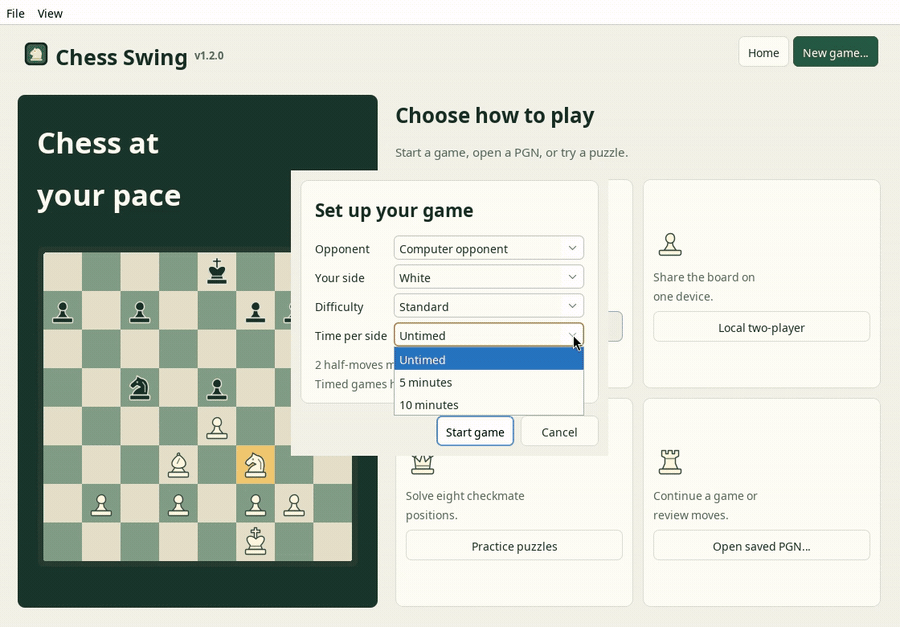
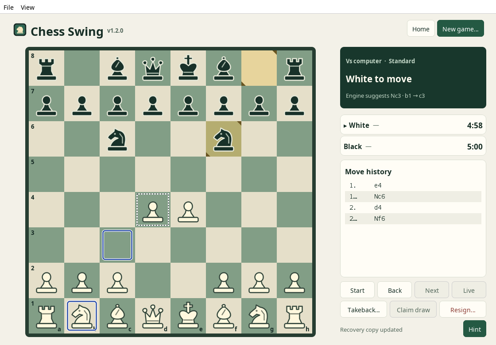
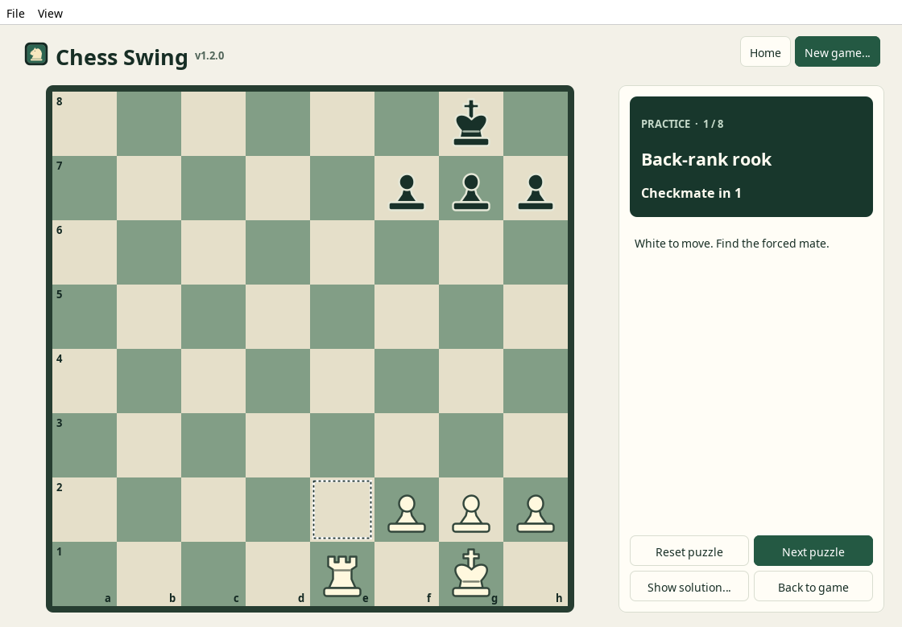
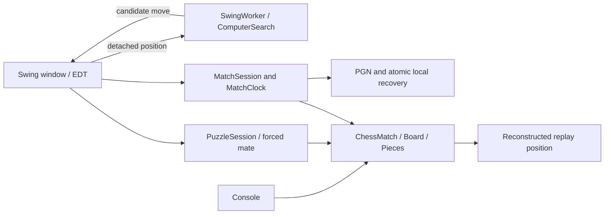

# Chess Swing

**Release v1.2.0.** A Java 21 desktop chess game for two people sharing a board or one person playing a local computer opponent. Play untimed or with a 5- or 10-minute clock per side, then review the game or export it as PGN.


<details>
<summary>Watch the visual redesign demo</summary>



</details>

[Try a sample PGN](docs/examples/ruy-lopez.pgn) · [Read the technical notes](docs/TECHNICAL-NOTES.md) · [See what changed](docs/CHANGES.md)

## Visual redesign





[Dark Home](docs/screenshots/dark-home.png) · [Compact dark play](docs/screenshots/dark-compact.png) · [Compact high contrast](docs/screenshots/high-contrast.png) · [Enlarged UI](docs/screenshots/enlarged.png)

The small v1.1.0 welcome box has become a flexible start screen with an original board illustration and four mode cards. The play and practice screens now share a framed board, consistent vector pieces, and coordinated controls. Use **View → Light**, **Dark**, or **High contrast**. **Ctrl+H** switches between high contrast and your previous appearance. Theme changes leave the live game in place.

On the board, corner wedges identify the last move, a solid frame marks selection, and a double frame marks check. A dot or circle shows a legal move or capture. Rounded outlines mark hints, and the dotted ring marks keyboard focus. A triangle beside a player’s name indicates the side to move in a live game.

## What you can do

- Set up a local or computer game, choose White or Black, and pick a difficulty and optional clock. The computer runs locally and requires no service.
- Play standard chess with checkmate, stalemate, castling, en passant, and promotion. The board marks legal moves, captures, last moves, and check.
- Read standard algebraic notation (SAN), import and export PGN, replay positions, and request takebacks. The app saves a separate local recovery copy.
- Ask for a legal engine suggestion on a human turn, or solve eight original checkmate exercises in a separate practice session.
- Resize or flip the board and switch on high contrast. Board navigation and replay are available by keyboard.

## Run and test

Download the [v1.2.0 JAR](https://github.com/mustafaalazzawi1/chess-swing/releases/download/v1.2.0/chess-swing-v1.2.0.jar) and run it with **Java 21 or newer**:

```sh
cd ~/Downloads
java -jar chess-swing-v1.2.0.jar
```

Build from source with a **JDK 21 or newer**. The source ZIP includes the pinned FlatLaf JAR, and the build verifies its checksum and bundles it into the runnable JAR. No dependency download is needed to build. Run these commands from the source folder in a POSIX shell such as Terminal, Bash, or Git Bash:

```sh
./build.sh --test
./scripts/smoke-jar.sh
java -jar build/chess-swing.jar
```

Add `--console` for the original-style untimed, local terminal mode. Enter coordinates such as `e2 e4`, or `e7 e8 n` for promotion. Enter `draw`, `f` to resign, or `quit`.

### macOS app bundle

On a Mac, install a **JDK 21 or newer matching the target CPU** (arm64 for Apple silicon or x64 for Intel). Download and extract the v1.2.0 source ZIP into Downloads, open Terminal, and run:

```sh
cd ~/Downloads/chess-swing-v1.2.0-source
export JAVA_HOME=$(/usr/libexec/java_home -v 21)
bash scripts/package-macos.sh
```

If you prefer another supported JDK, set `JAVA_HOME` to its JDK home. The script runs the same build and tests, generates an ICNS icon, and uses `jpackage` to create a Finder-launchable app with a bundled Java runtime. Open `build/macos/ChessSwing-macos-arm64.zip` or `build/macos/ChessSwing-macos-x86_64.zip` in Finder, then open **Chess Swing.app**. Verify that it launches, shows its icon, and can start a computer game. For a runtime-isolation check, repeat on a Mac of the same architecture without a system JDK.

**Owner-supplied evidence for v1.0.0 on Apple silicon.** Mustafa reported that `package-macos.sh` passed all 33 automated groups and the JAR smoke test and produced `ChessSwing-macos-arm64.zip`. His screenshot shows the native app open with its Dock icon, an untimed local game with `1. g3 g6`, and “Black wins by resignation.” The full-desktop diagnostic image is excluded from the review assets.

**Owner-supplied macOS smoke checks.** The v1.2.0 JAR launched on Mac and displayed Home, Resume, and Practice with the new piece artwork and readable controls. The earlier v1.0.1 JAR smoke test covered computer and timed play. These are limited UI and gameplay checks.

**Native bundle.** A rebuilt v1.2.0 Finder app has yet to be tested. The release includes the runnable JAR and buildable source. Use the macOS packaging instructions above to build and test the bundle locally. Signing and notarization are unverified.

## Choose how to play

- **Play computer** opens setup with the computer selected. Choose your side, difficulty, and time per side. **Local two-player** opens setup for two people sharing the board.
- **Open saved PGN…** imports a game. **Resume game** opens the current or recovered game. Home and practice pause live clocks and cancel computer work until you resume. Starting or importing a replacement still prompts before discarding unsaved progress.
- **Practice puzzles** contains five mate-in-one and three mate-in-two exercises. All legal winning moves are accepted. A move that misses the objective leaves the board in place. In mate-in-two puzzles, the app plays a legal defense before asking for the final mate. Use **Reset puzzle**, **Next puzzle**, or **Show solution…**. Practice progress is kept only while the app is open.
- **Hint** or **Ctrl+J** offers a legal move on the human side's turn in an active game. In local play, either player may request a hint on their own turn. Two outlined squares show the suggestion. It does not play a move, edit recovery, or pause either clock. Hints are unavailable in replay, practice, dialogs, computer turns, and ended games.

Chess Swing is a Java desktop app.

## Game controls

| Action | Control |
| --- | --- |
| Start a game | **Play computer**, **Local two-player**, or **New game…** (Ctrl+N) |
| Request a hint | **Hint** or Ctrl+J on your turn |
| Return to a game | **Resume game** from Home or **Back to game** from practice |
| Move a piece | Click a piece and destination, or focus the board with Ctrl+B and use arrows plus Enter or Space |
| Clear selection | Esc or click the selected square |
| Replay a position | Select a move in history or use **Start**, **Back**, and **Next** |
| Replay shortcuts | Alt+Home, Alt+Left, Alt+Right, and Alt+End to return live |
| Flip or boost contrast | F to flip; Ctrl+H to toggle the high-contrast board |
| Open or save PGN | Ctrl+O or Ctrl+S |
| End a game | Use **Claim draw** when enabled, or **Resign** |

### Difficulty

| Level | Maximum depth | Search budget |
| --- | ---: | ---: |
| Casual | 1 half-move | 125 ms |
| Standard | 2 half-moves | 400 ms |
| Deep | 3 half-moves | 850 ms |

The engine searches progressively deeper with alpha-beta pruning. It keeps the last fully searched choice, with a legal fallback if the budget expires early. The budgets are checked between search operations and are approximate wall-clock targets. There are no Elo estimates.

### Clocks, takebacks, and recovery

- Timed games use a per-side countdown with no increment. The live side's clock runs during a computer search as well as a human turn. At zero the game ends before a pending move may be accepted. The clock stops when the game ends.
- Replay pauses the live clock and shows the recorded times at the displayed move. Setup, file and confirmation dialogs, promotion selection, and import validation pause live time and cancel computer work. Leaving replay or closing a dialog restores the live turn. Outside the app's dialogs, live clocks continue even if the window loses focus.
- Local takebacks require both players' confirmation and rewind one half-move. In computer mode, one confirmation returns to the human's previous choice and removes the reply if it is already recorded. The board, rule state, capture display, and both clocks rewind together.
- The app writes a local recovery PGN at `~/.chess-swing/recovery.pgn` after moves and transitions and roughly every five seconds in timed play. Recovery restores opponent, difficulty, side, checkpoints, and the most recently saved clock reading. Time away from the app does not count. A sudden termination can lose time elapsed since the last write.
- Regular PGN export includes SAN and the nominal time control when applicable. PGN import opens the main line as an untimed local game. Per-move clock snapshots and computer settings belong to local recovery; saving during replay exports the full live move list.

[Game setup] · [Engine hint] · [Practice] · [Solved puzzle] · [Compact high contrast]

[Game setup]: docs/screenshots/setup.png
[Engine hint]: docs/screenshots/gameplay.png
[Practice]: docs/screenshots/practice.png
[Solved puzzle]: docs/screenshots/puzzle-solved.png
[Compact high contrast]: docs/screenshots/high-contrast.png

## Architecture



`ChessMatch` owns legality and automatic outcomes. `ComputerSearch` works from a detached copy. Swing rechecks the worker identity, current turn, live state, clock, and move legality before committing the result. `MatchSession` coordinates moves and clock checkpoints. PGN and the terminal entry point reuse the same rule engine.

## Verification and scope

The local build runs **40 test groups**: all 33 baseline groups plus 7 learning groups covering hint guards, clocks, every puzzle defense, alternative wins, and isolation. The rules checks include starting-position perft at depths 1–3 and Kiwipete at depths 1–2. The packaged JAR smoke test checks console checkmate and the icon resource. The workflow pins its Actions and Temurin version. Its commands ran locally on Linux with the pinned Temurin build. GitHub Actions runs the build and smoke test against the published source.

v1.2.0 was exercised on Linux using the packaged JAR. The focused layout check covered Home, play, and practice at default and minimum sizes in all three appearances, with standard and 18-point control and label fonts. It checks full labels, keyboard focusability, and theme colors after switching. The actual GUI was also inspected at 125% scale. Run it on a graphical display after building the tests:

```sh
java -cp build/classes:build/test-classes oopchesscode.game.ChessWindowLayoutTest
```

The application plays orthodox, local chess only and reads one UTF-8 PGN main line per file, up to 512 KiB. PGN comments, annotations, and variations are skipped. Draw claims use the current position. Dead-position and flag-fall mating-material checks cover common cases and do not solve arbitrary reachability. Search is shallow and uses a material-and-position heuristic without an opening book, tablebase, or rating.

## Attribution

Mustafa Al Azzawi created the original ChessCode Java/Swing project. This repository preserves its Java/Swing foundation, board and piece classes, and console mode. The rule fixes, desktop redesign, PGN and replay work, computer search, clocks, and packaging in this revision were developed with Codex assistance at Mustafa's direction. Earlier review builds were reviewed by Mustafa. The app icon and the Java2D piece and board artwork were created for Chess Swing. The screenshots and demo are captures of the running app. See [asset and dependency attribution](docs/ASSETS.md).
