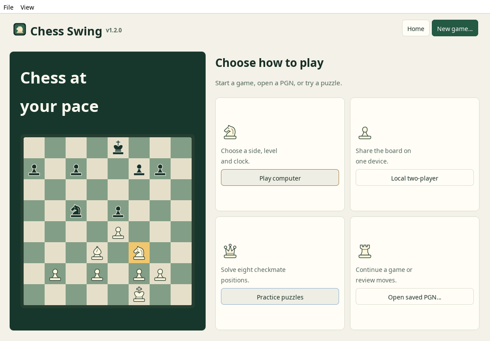

# Chess Swing

**A Java 21 desktop chess application by Mustafa Al Azzawi.**

Play against a local computer opponent or another person on the same board. Use optional clocks, review and save games, or practice checkmate puzzles.

[Download v1.2.0](https://github.com/mustafaalazzawi1/chess-swing/releases/tag/v1.2.0) · [User guide](docs/USER-GUIDE.md) · [Architecture and design](docs/TECHNICAL-NOTES.md) · [Gameplay demo](docs/demo/gameplay.gif)



## Features

- **Standard chess:** legal-move validation, king safety, checkmate, stalemate, castling, en passant, and four promotion choices.
- **Computer play:** three search levels, either color, and optional 5- or 10-minute clocks. The opponent runs locally.
- **Game review:** SAN move history, PGN import and export, replay, takebacks, and local recovery.
- **Practice:** legal engine hints and eight mate-in-one or mate-in-two puzzles that accept alternative winning moves.
- **Desktop interface:** resizable board, original Java2D pieces, keyboard controls, and light, dark, and high-contrast themes.

[Timed gameplay](docs/screenshots/gameplay.png) · [Practice](docs/screenshots/practice.png) · [Dark theme](docs/screenshots/dark-home.png) · [Sample PGN](docs/examples/ruy-lopez.pgn)

## Run

Download `chess-swing-v1.2.0.jar` from the [release page](https://github.com/mustafaalazzawi1/chess-swing/releases/tag/v1.2.0). With **Java 21 or newer** installed:

```sh
java -jar chess-swing-v1.2.0.jar
```

Run the command from the folder containing the JAR. Choose **Play computer**, **Local two-player**, or **Practice puzzles** from Home.

## Build and test

With a **JDK 21 or newer**, run these commands from the project folder in a POSIX shell such as Terminal, Bash, or Git Bash:

```sh
./build.sh --test
./scripts/smoke-jar.sh
java -jar build/chess-swing.jar
```

The repository and release source ZIP include the pinned FlatLaf dependency and its license. The build verifies the dependency checksum and needs no dependency download.

## Engineering

The Swing and console interfaces share one rules engine. Computer search runs on a detached position outside Swing's event thread; the live game revalidates a returned move before accepting it. A monotonic clock and recorded checkpoints support timed play, replay, takebacks, and recovery.

[Architecture and design](docs/TECHNICAL-NOTES.md) explains the implementation, tradeoffs, and development history.

## Verification and scope

**40 automated test groups** cover rules, notation, file handling, replay, computer search, clocks, and practice. The packaged-JAR smoke test and [hosted release verification](https://github.com/mustafaalazzawi1/chess-swing/actions/runs/45368356365) passed. Public release downloads were also [verified against their checksums](https://github.com/mustafaalazzawi1/chess-swing/actions/runs/45370348643).

Linux verification includes GUI and layout checks. The v1.2.0 JAR has limited macOS launch and interface verification. A prebuilt v1.2.0 Mac app is not included; [build instructions and platform coverage](docs/BUILD-AND-VERIFICATION.md) describe the remaining checks.

Play is local. The computer has no Elo rating, PGN import retains one game's main line, and dead-position detection covers common cases. See the [documented limits](docs/TECHNICAL-NOTES.md#scope-and-tradeoffs).

## Documentation

- [User guide and keyboard controls](docs/USER-GUIDE.md)
- [Architecture and design](docs/TECHNICAL-NOTES.md)
- [Build, Mac packaging, and verification](docs/BUILD-AND-VERIFICATION.md)
- [Changelog](docs/CHANGES.md)
- [Artwork and dependency credits](docs/ASSETS.md)

## Author

Created by **Mustafa Al Azzawi**, building on his original ChessCode Java/Swing project.
