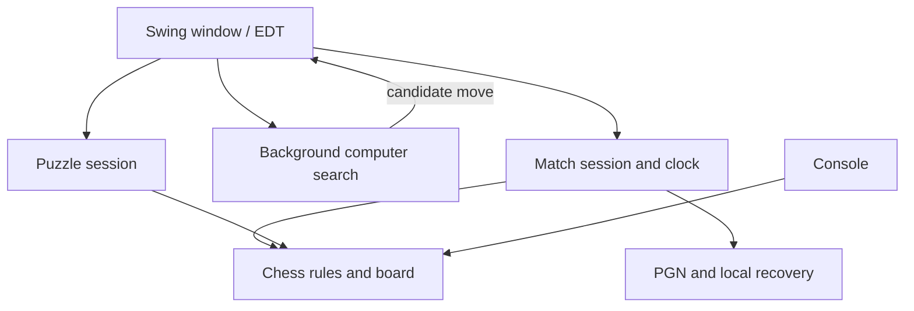

# Architecture and design

Chess Swing separates legal chess state, match timing, computer search, persistence, and desktop presentation. The Swing and console entry points share the same rules engine.

## Rules and state

A square click passes through `ChessWindow`, `MatchSession`, and `ChessMatch.play`. Piece geometry produces candidates. The engine simulates a candidate, checks king safety, and restores the temporary board before deciding whether to commit it.

A repetition key includes board occupancy, the turn, castling rights, and an en passant square only when a legal capture is available. Move-count and repetition rules depend on this state even when two boards look identical.

## Search and concurrency

`ComputerSearch` uses negamax with alpha-beta pruning and iterative deepening. Negamax evaluates each position from the current player's perspective; alpha-beta skips branches that cannot improve the decision. The search keeps the result from the last completed depth and a legal fallback when its budget expires.

The evaluation combines material with simple positional bonuses. Piece values are pawn 100, knight 320, bishop 330, rook 500, and queen 900. Center proximity benefits pieces, and pawn advancement adds a small bonus. Terminal mate scores dominate material; terminal draws score zero.

Search runs through `SwingWorker` on a detached position. Separate workers serve computer turns and hints. New games, imports, replay, takebacks, dialogs, or closing the window can invalidate pending work. The completion handler checks worker and session identity, turn, live view, clock, and move legality on Swing's event thread before accepting a computer reply.

Copying positions makes isolation straightforward at this scale, at the cost of more allocations than a make/unmake search.

## Notation, replay, and takebacks

SAN is computed from the pre-move position. When another legal piece of the same type can reach the destination, notation includes the minimum file or rank disambiguation. Check and mate suffixes come from the resulting position.

Replay and takebacks rebuild from the validated starting position and a prefix of recorded moves. This avoids separate inverse-move logic for castling, en passant, and promotion. Reconstructing earlier positions takes longer in very long games.

## Clocks and recovery

`MatchClock` uses `System.nanoTime()`. Sampling charges the active turn, and each accepted move records both clock readings. Tests use a fake monotonic clock to exercise pauses, replay, takebacks, flag fall, and recovery without timing-dependent sleeps.

PGN stores the portable move record. Local recovery adds versioned session settings and bounded clock checkpoints. Recovery validates the clock ledger against the number and color of moves. A file lock gives one window ownership of the recovery copy.

Timed play pauses in Home, practice, replay, and application dialogs. Outside those dialogs, losing window focus does not pause the game. This pause policy supports local play and review; it is not an online competitive clock.

## Hints and puzzles

A hint uses bounded search without committing the suggested move. Its completion callback validates worker, session and match identity, ply, live view, side, clock, and final legality. Checking only the ply is insufficient because a takeback may recreate a position in a replacement match.

A mate-in-two attack qualifies only when every legal defense has a mating response. Tests independently enumerate attacks, defenses, and replies. Practice accepts alternative winning attacks and finishes, and chooses a defense with the fewest mating continuations.

Practice owns a separate puzzle board and feedback state. Returning to a paused match restores that match without applying any puzzle moves.

## Desktop presentation

`VisualStyle` owns the palette and FlatLaf defaults. Theme changes update the component tree while guarding history-selection callbacks; they do not change the match state.

`PieceArt` renders original Java2D silhouettes on the board, Home illustration, and capture display. The sidebar derives its width from the controls' preferred sizes. Minimum window dimensions account for both Home and board layouts. Layout checks cover button labels, keyboard focusability, and palette changes.

## Verification

The automated suite contains 40 test groups across rules, PGN and files, sessions and clocks, and learning features. Rules checks include starting-position perft through depth 3 and Kiwipete through depth 2. A packaged-JAR smoke test exercises console checkmate and the icon resource.

Hosted [release verification](https://github.com/mustafaalazzawi1/chess-swing/actions/runs/45368356365) checked out the exact v1.2.0 source and passed. The [publishing job](https://github.com/mustafaalazzawi1/chess-swing/actions/runs/45370348643) rebuilt from the source ZIP and verified anonymous public downloads against the expected hashes.

See [Build and verification](BUILD-AND-VERIFICATION.md) for commands, GUI checks, and platform coverage.

## Scope and tradeoffs

- Local, orthodox chess; no network multiplayer.
- Three shallow search levels with approximate time budgets. There is no opening book, tablebase, or measured Elo.
- PGN import retains one UTF-8 game's main line, up to 512 KiB. Comments, annotations, and variations are skipped.
- Draw claims apply to the current position. Dead-position and flag-fall mating-material detection cover common cases rather than arbitrary reachability.
- Practice progress is in memory. Recovery resumes from its last saved clock readings without charging time spent away.
- Tests establish behavior for covered cases; they are not a proof of every legal chess position.

## Development history

Mustafa Al Azzawi created the original ChessCode Java/Swing application. Chess Swing retains that foundation, including the board and piece classes and console mode. The later rules, interface, search, clock, persistence, and packaging work was developed with AI coding assistance under his direction, with hands-on application testing and feedback from Mustafa.

[Artwork and dependency credits](ASSETS.md) identify the original project artwork and the bundled FlatLaf library.

## View separation after v1.2.0

`ChessWindow` coordinates sessions, clocks, replay, file operations, and asynchronous search. Presentation is split into `ChessBoardView` (rendering, orientation, keyboard focus, square callbacks), `ChessHomeView` (mode selection and resume), and `ChessPracticeView` (puzzle controls and feedback). `SwingControls` centralizes accessible buttons and keyboard bindings. Views receive data or intent callbacks; they do not apply chess moves or own a live session.

The refactor reduces the window from 1,176 to 831 lines without changing rules, clock policy, or search settings. Three view-contract checks exercise coordinate mapping after a flip, stale hint removal, non-mutating callbacks, mode actions, and resume labels. The existing 40 engine/session groups and packaged-JAR smoke test remain in place; CI also runs the existing window-layout checks on a virtual display. This is a source maintenance change after the v1.2.0 release; published v1.2.0 binaries remain unchanged.
